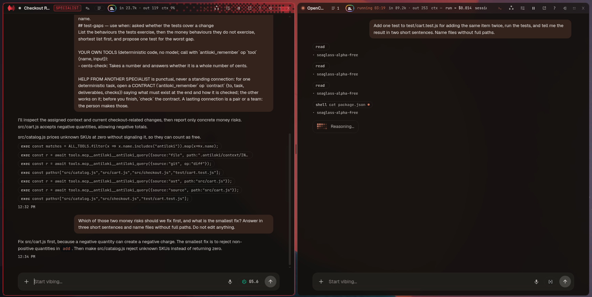
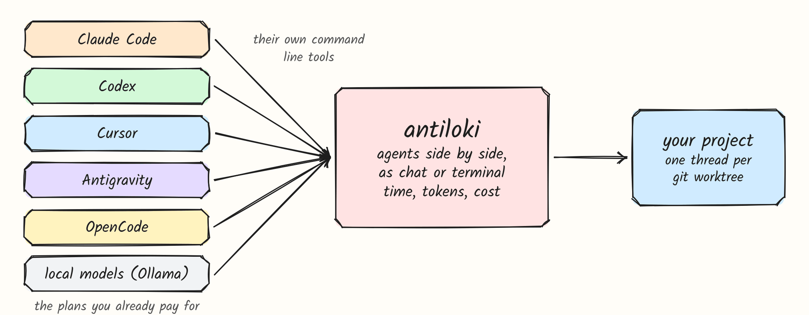
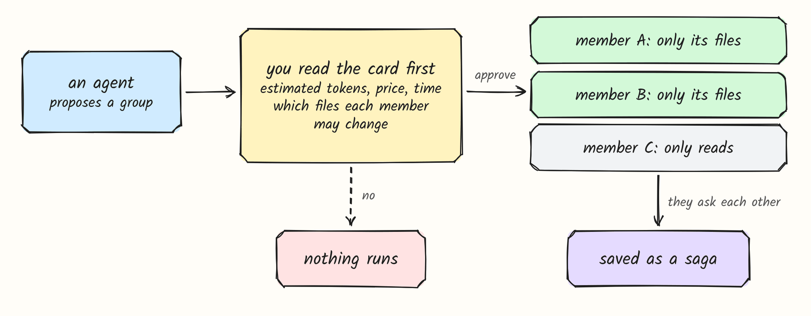
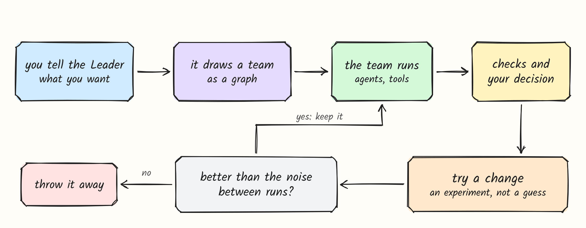
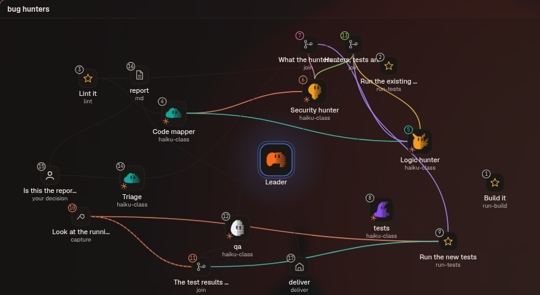

<p align="center"></p>

<h1 align="center">antiloki</h1>

<p align="center">
  <a href="https://patreon.com/danjindev"></a>
  &nbsp;
  <a href="https://www.buymeacoffee.com/danjindev"></a>
</p>
<p align="center"><sub>antiloki is free and open source. If it saves you time, helping us keep working on it means more fixes, a Windows build and faster releases.</sub></p>

**A vibe graphing IDE.** Instead of prompting for a result, you build the team that produces it. antiloki draws a team of AI agents as a graph, runs it, tests it, and improves it by experiment. Prompt once; the team does the rest.

[](LICENSE)
[](https://antiloki.com/docs.html)
[](https://github.com/antiloki/antiloki-releases/releases)

**Free and open source.** No account, no trial clock, nothing to unlock. Licensed under [Apache-2.0](LICENSE).

> Status: pre-1.0 and moving fast. Linux and Windows. There is no macOS build.

<p align="center"></p>

## What it does

**Agents side by side**

<p align="center"></p>

- **Threads and panes.** Terminals, agents, files, browsers and your own apps on one screen, one thread per git worktree. Every agent can be read as a chat or as its terminal.
- **Your own subscriptions.** antiloki drives the AI subscriptions you already pay for through their own command line tools: Claude Code, Codex, Cursor, Antigravity and OpenCode. No API keys are required. Time, tokens and cost are shown per agent.
- **Local models** through Ollama.

**Agents working together** *(new)*

<p align="center"></p>

- **Groups.** An agent proposes a group of specialists and ordinary agents, on any provider. You see the estimated tokens, price and time, and which files each member may change, **before** you approve it. Members ask each other, a finished group is saved as a saga.
- **Held to their files.** A member changes only the files on the card: Claude Code through a pre-write check, the others inside an operating-system sandbox on a copy of your project (Linux, `bubblewrap`).
- **Messages and questions.** An agent can ask a specialist even when it is not running, or leave a message that waits until the other is idle.
- **Contracts.** One specialist hands another a task with checks; it is done only when the checks pass.
- **Routines.** A specialist does a task daily or every so often, with a budget per run. A routine is off until you switch it on, and runs only while antiloki is open.
- **Board.** Every running agent, what it is doing, the tasks between them and your routines, with pause and Stop all.

**Specialists and teams**

<p align="center"></p>

<p align="center"></p>
<p align="center"><sub>One of the built-in team templates, drawn as a graph.</sub></p>

- **Specialists.** Agents with a job, a persona, their own checks and a memory that grows from their sessions.
- **Teams as graphs.** Agents, tools, checks, forks and human gates. A *Leader* chat draws the graph from what you ask for; watch it as a graph, in an editor, or over time.
- **Evolve and Swarm.** A team improves itself by experiment. A change is kept only if its gain beats the run-to-run noise.

**Working on your machine**
- **A real browser for agents**, in a window you watch. You sign in; you allow each site, and again for anything that sends, buys, deletes or submits.
- **Files pane** that opens text, pictures, sound and video; drag a file onto an agent.
- **Connectors.** Ask an agent to connect a service and a screen opens with the steps and the fields for the keys. Keys stay on your machine; agents never see them.
- **Your machine comes first.** Agents pause when memory or processor run short and continue by themselves, or when you press pause.
- **Pull requests** on GitHub, Gitea and Forgejo.
- **Themes**, including ones an agent makes for you.
- **Everything is a tool.** An MCP server (`antiloki-agent`) exposes the app to any agent.

Full documentation: **<https://antiloki.com/docs.html>**

## Install

> The ready-made [AppImage release](https://github.com/antiloki/antiloki-releases/releases) is **older** than this code and does not have the features marked *new*. To get them, install from source with one of the two ways below. Linux; Windows is not covered here.

### Option 1: let your AI agent do it

Paste this into Claude Code, Codex, Cursor or another coding agent running in a terminal:

```text
Install and run antiloki on this Linux computer, from source.

1. Check that these exist: git, a C compiler, Rust 1.95 or newer (cargo), Node.js 22 with npm, and about 10 GB of free disk. If something is missing, tell me what you would install and wait for my yes before installing it.
2. In ~/antiloki-dev, clone https://github.com/antiloki/antiloki-app and https://github.com/antiloki/antiloki-ui side by side (pull if they are already there).
3. In antiloki-ui run: npm ci && VITE_BE_URL=http://localhost:41999 npx vite build
4. In antiloki-app run: cargo build -j 2 -p antiloki-serve -p antiloki-agent
   The first build is long and uses a lot of memory. Run one build at a time and do not raise -j on a machine with 16 GB or less.
5. Check that nothing already listens on port 41999. Then start the server from antiloki-app, detached so it keeps running, with its output in ~/antiloki-dev/serve.log:
   ANTILOKI_SERVE_PORT=41999 ANTILOKI_FE_DIR="$HOME/antiloki-dev/antiloki-ui/dist" ANTILOKI_AGENT_BIN="$PWD/target/debug/antiloki-agent" ANTILOKI_PTY_HOST=sidecar ./target/debug/antiloki-serve
6. Wait until http://localhost:41999 answers, then tell me the address, where the log is, and how to stop the server. If any step fails, show me the error and stop; do not work around it.

Do not use sudo without asking me, and do not change my shell profile or any system setting.
```

### Option 2: by hand

**Needs:** Linux, git, a C compiler, Rust 1.95 or newer, Node.js 22, about 10 GB of free disk. At least one agent command line tool (for example Claude Code) installed and signed in. For groups with members from other providers, `bubblewrap` (`bwrap`).

```bash
mkdir -p ~/antiloki-dev && cd ~/antiloki-dev
git clone https://github.com/antiloki/antiloki-app
git clone https://github.com/antiloki/antiloki-ui

# 1. the screen
cd ~/antiloki-dev/antiloki-ui
npm ci
VITE_BE_URL=http://localhost:41999 npx vite build

# 2. the server and the agent helper (long the first time)
cd ~/antiloki-dev/antiloki-app
cargo build -j 2 -p antiloki-serve -p antiloki-agent

# 3. run
ANTILOKI_SERVE_PORT=41999 \
ANTILOKI_FE_DIR="$HOME/antiloki-dev/antiloki-ui/dist" \
ANTILOKI_AGENT_BIN="$PWD/target/debug/antiloki-agent" \
ANTILOKI_PTY_HOST=sidecar \
./target/debug/antiloki-serve
```

Open **<http://localhost:41999>**, press **Start here** and choose your project folder. Stop it with `Ctrl+C` (open terminals are kept by a small helper and come back next time). Your data is in `~/.local/share/antiloki` and `~/.antiloki`.

To update, run these in **each** of the two folders, then repeat steps 1 to 3. Each update replaces the public history, so `git pull` does not work. The second command throws away any change you made to the repository's own files:

```bash
git fetch origin
git reset --hard origin/main
```

## Develop

antiloki is two repositories that sit **side by side** in one folder:

| Repo | What |
|---|---|
| [`antiloki/antiloki-app`](https://github.com/antiloki/antiloki-app) (this one) | Rust: the backend (`serve`), the desktop shell (`tauri`), the MCP sidecar (`agent`), the skills |
| [`antiloki/antiloki-ui`](https://github.com/antiloki/antiloki-ui) | The front end: React, TypeScript, Vite |

With the server above running, `cd antiloki-ui && VITE_BE_URL=http://localhost:41999 npm run dev` serves the screen with reload on <http://localhost:5173>.

**Build the desktop app** (needs the [Tauri prerequisites](https://tauri.app/start/prerequisites/)): `scripts/desktop-build.sh` (Windows: `scripts/desktop-build-windows.sh`).

**Test:**

```bash
cd antiloki-app && cargo test -p antiloki-serve --lib && cargo test -p antiloki-agent
cd antiloki-ui && npm run typecheck && npm test
```

See [CONTRIBUTING.md](CONTRIBUTING.md) for how to work on it without running out of memory.

## Layout

```
serve/       the HTTP backend (Rust, axum, SQLite): teams, runs, panes, specialists, MCP gate
tauri/       the desktop shell (Tauri 2)
agent/       antiloki-agent: the MCP server, hooks and status line agents talk to
src/         the skills library (deterministic building blocks)
templates/   shipped team templates and free-pane examples
```

## Honest limits

- pre-1.0: expect rough edges, especially on Windows, which is less tested than Linux.
- Local models are slow without a GPU.
- The core library's conformance suite needs fixtures that live in a private repository; run the `serve` and `agent` tests instead.

## Support the project

antiloki is free and open source, built by a small team. If it saves you time, supporting it helps us keep working on it: more fixes, a Windows build, faster releases.

- **Patreon:** <https://patreon.com/danjindev>
- **Buy me a coffee:** <https://www.buymeacoffee.com/danjindev>
- Starring the repo, reporting a bug or sending a pull request also helps a lot.

## License

Apache-2.0. See [LICENSE](LICENSE) and [NOTICE](NOTICE).
